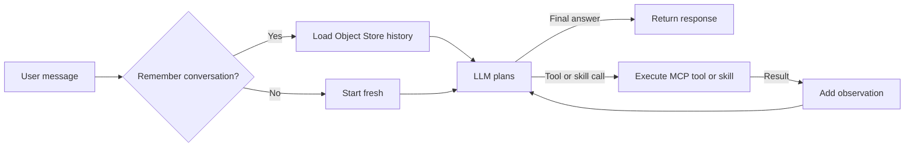
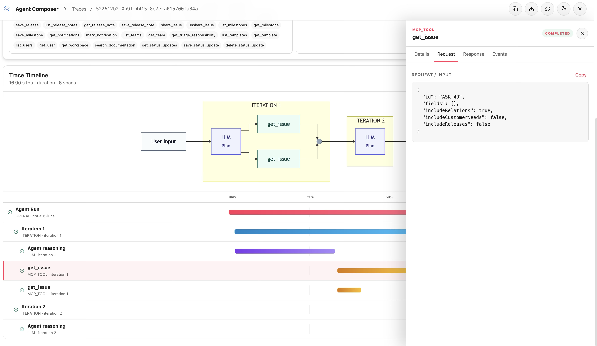

# Agent Composer for Mule 4

Agent Composer is a Mule SDK connector for building ReAct agents without custom Java orchestration. It combines OpenAI, Anthropic, or a custom OpenAI Responses-compatible endpoint with MCP tools, skills, optional conversation memory, A2A HTTP endpoints, and execution traces.

## Demo video

[Watch the Agent Composer demo on YouTube](https://youtu.be/0LPJfMQhAAo).

## Current version

```xml
<dependency>
  <groupId>com.k2</groupId>
  <artifactId>agent-composer</artifactId>
  <version>1.1.0</version>
  <classifier>mule-plugin</classifier>
</dependency>
```

Java 17 and Mule 4 are required.

## Quick start

```xml
<agent-composer:config name="Agent_Composer">
  <agent-composer:llm-provider>
    <agent-composer:open-ai modelName="gpt-4o" apiKey="${OPENAI_API_KEY}" />
  </agent-composer:llm-provider>
</agent-composer:config>

<flow name="agent-flow">
  <agent-composer:agent-listener config-ref="Agent_Composer" />
  <agent-composer:execute-agent config-ref="Agent_Composer" maxIterations="10" />
</flow>
```

Conversation memory is disabled by default. Enable **Remember Conversation** when turns with the same conversation ID should share history and solved-response cache entries.

## ReAct engine



The **Max Iterations** value on Execute Agent is the authoritative outer-loop limit.

## Capabilities

- Provider-specific OpenAI, Anthropic, and Custom LLM configuration.
- Direct MCP tools and higher-level agent skills.
- MCP Streamable HTTP tool discovery and execution.
- A2A 0.3 and 1.0 JSON-RPC endpoints, including streaming.
- Opt-in Object Store conversation history and solved-response caching.
- Redacted traces with Mermaid flow, waterfall, span table, MCP inventory, metrics, and a running-task stop control.
- Configurable agent and trace paths.

## Documentation

- [Global configuration and LLM providers](docs/configuration.md)
- [Operations](docs/operation-reference/index.md)
- [Agent Listener and trace console](docs/agent-listener.md)
- [A2A support matrix](docs/a2a-support.md)
- [MCP support](docs/mcp-support.md)
- [ReAct runtime behavior](docs/react-engine.md)

## Trace Report

Agent Composer records each agent run as a execution trace. The report is available from the configured **Traces Path**, which defaults to:

```text
http://<host>:<listener-port>/agent/traces
```

The trace index lists recent executions. Select an execution to inspect its ReAct flow, iteration and tool-call waterfall, span table, request and response data, errors, timing, token metrics, and connected MCP server/tool inventory. Selecting a span opens its details in the fixed right-hand drawer without changing the height of the timeline.



The tracing UI is configurable through the Agent Composer global configuration. Set **Traces Path** to host it at the route appropriate for the application; the default is `/agent/traces`. Users can switch between light and dark themes from the report, and the selected appearance is retained in the browser. The UI also provides compact actions for refreshing and exporting redacted JSON.

While an execution is running, **Stop Task** requests a best-effort in-process cancellation. Cancellation cannot reverse external tool side effects that have already completed.

Trace HTTP endpoints:

| Method | Endpoint | Result |
|---|---|---|
| `GET` | `{tracesPath}` | Recent trace index. |
| `GET` | `{tracesPath}?executionId=<id>` | Interactive report for one execution. |
| `GET` | `{tracesPath}?executionId=<id>&format=json` | Redacted trace JSON. |
| `POST` | `{tracesPath}?executionId=<id>&action=cancel` | Requests cancellation of a running execution. |

Execute Agent responses include `executionId` and `traceReportPath`, so applications can link directly to the relevant report. Configure a different route with **Traces Path** in the Agent Composer global configuration. See [Agent Listener and traces](docs/agent-listener.md) and [Trace operations](docs/operation-reference/traces.md) for the complete contract.

## Defaults

| Setting | Default |
|---|---:|
| Temperature | `1.0` |
| Max output tokens | `1000` |
| Execute Agent max iterations | `5` |
| Remember conversation | `false` |
| Include MCP tools as skills | `false` |
| MCP retry count | `0` |
| Agent path | `/agent` |
| Traces path | `/agent/traces` |

## Security

- Use secure properties for API keys, bearer tokens, and custom headers.
- Trace data is redacted for common credential fields and bearer tokens, but applications should still avoid putting secrets into prompts.
- Stop Task interrupts work in the current Mule runtime; it cannot revoke side effects already committed by an external MCP tool.
- Use HTTPS and authentication in front of Agent Listener and trace endpoints in deployed environments.
