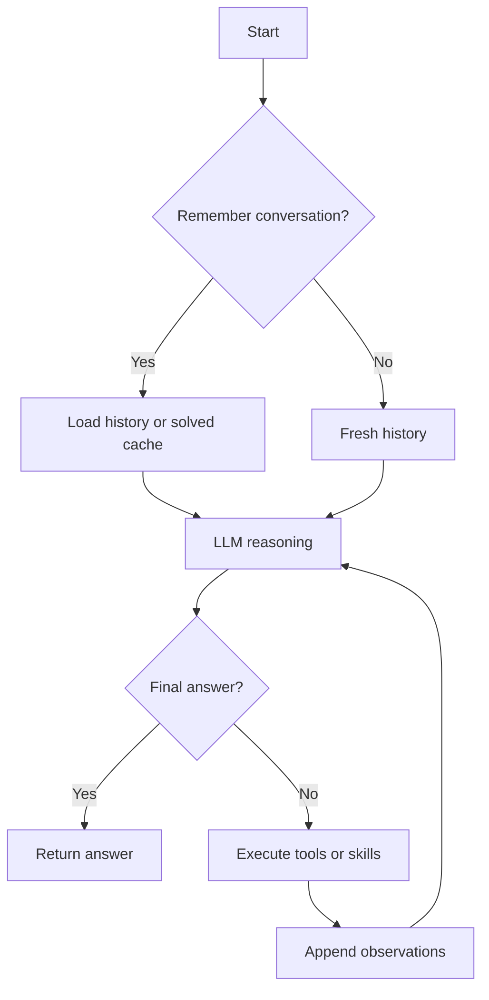

# ReAct engine

Independent calls in a model turn execute concurrently while results are collected in original LLM order. Skills run in a bounded nested loop that shares the configured iteration budget.

Tool schemas are shared per server configuration for the life of the deployment. A changed name, URL, filter, or authentication identity creates a new discovery key.
